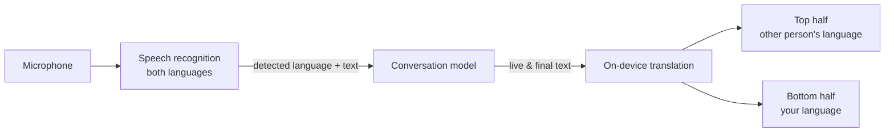

# EasyTrans

Live interpreter for conversations at a table. Put the phone between two people and both just talk:
EasyTrans detects which of the two languages is being spoken and shows each person only the
translation of what the *other* person said. The top half is rotated 180° so the person across the
table can read it.

- **No buttons while talking** – the speaking language is detected automatically.
- **Live** – the translation appears while the sentence is still being spoken.
- **On-device** – translation runs locally; no account, no ads, no tracking, no backend.
- **Minimal UI** – plain text, one floating control bar, locked to portrait.

| Platform | Stack | Speech | Translation | Status |
|---|---|---|---|---|
| [Android](android/) | Kotlin, Jetpack Compose | `SpeechRecognizer` with language detection (Android 14+) | Google ML Kit, on-device | Builds, runs in emulator, release AAB ready |
| [iOS](ios/) | Swift, SwiftUI, Liquid Glass | `SpeechAnalyzer`, one transcriber per language (iOS 26+) | Apple Translation, on-device | Builds; signing blocked by Apple's current 2FA changes for third-party tools |

## How it works



Each utterance is attributed to the language the recognizer detected. While it is being spoken,
the partial text is translated continuously (at most one translation in flight, always the newest
text) and shown dimmed on the listener's side; once final, it becomes a regular line in the
conversation.

- **Android** relies on the system recognizer's built-in language detection and switching.
- **iOS** feeds the microphone into two `SpeechTranscriber`s at once and, per time range, picks the
  one whose result is most plausible (transcription confidence plus a language check of the text).

## Repository layout

```
.
├── android/              Android app (Gradle, Kotlin, Compose)
│   └── app/src/main/java/io/github/maikderksen/easytrans/
├── ios/                  iOS app (SwiftPM package built with xtool)
│   ├── Sources/EasyTrans/
│   └── scripts/          WSL toolchain setup and build helpers
└── docs/
    ├── privacy-policy.html   Privacy policy (DE/EN) used for the store listing
    ├── play-store.md         Play Store release checklist and listing texts
    └── ui-preview/           Clickable HTML mock of the UI
```

## Getting started

- **Android:** see [android/README.md](android/README.md). Needs JDK 17+ and the Android SDK; runs in
  the Android Emulator.
- **iOS:** see [ios/README.md](ios/README.md). Builds on Windows/Linux via
  [xtool](https://xtool.sh); there is no iOS Simulator outside macOS.

## Security

- No secrets are stored in this repository. Signing keys, keystore passwords, Apple credentials and
  `local.properties` are git-ignored (see [.gitignore](.gitignore)).
- Android release signing reads `android/keystore.properties` locally (template:
  [keystore.properties.example](android/keystore.properties.example)) or `EASYTRANS_*` environment
  variables in CI. Without them, release builds are simply unsigned.
- The apps request only the permissions they need: microphone, plus internet on Android for the
  one-time model download.

## Privacy

The app has no backend and collects nothing itself. Speech recognition is done by the platform
(on-device where language packs are installed), translation runs on the device. Details:
[docs/privacy-policy.html](docs/privacy-policy.html).

## License

No license has been chosen yet; all rights reserved by the author until one is added.
